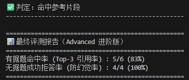
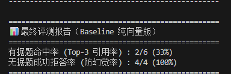
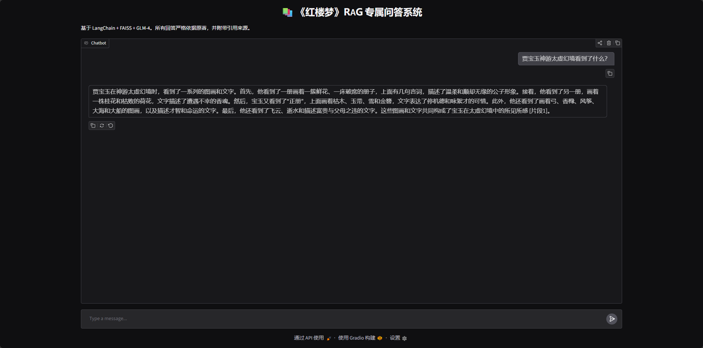
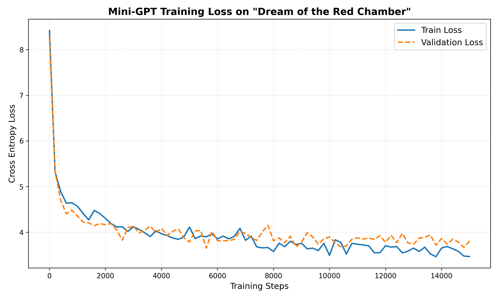

# Mini-RAG-QA-System

基于 LangChain + FAISS + 阿里云/智谱 API 构建的本地文档检索增强生成（RAG）问答系统。本项目不仅实现了端到端问答，还**从零手搓了 Mini-GPT** 以探索大模型底层原理，并**通过自建评测集完成了 RAG 链路的量化优化**。

## 🎯 项目动机
通用大语言模型（LLM）存在幻觉且缺乏私有知识。本项目旨在通过 RAG 技术，让模型能够基于本地文档（如《红楼梦》全本）进行精准回答、附带引用溯源，并严格限制模型“胡编乱造”。

## 🏗️ 核心系统架构
1. **文档加载与切块**：加载本地 `.txt` 文件，使用 `RecursiveCharacterTextSplitter` 进行滑动窗口切块（Chunk Size=500，Overlap=50），切分为 2515 个文本块。
2. **混合召回（Hybrid Search）**：
   * **语义召回**：使用本地 `bge-small-zh-v1.5` 模型将文本向量化，并存入 FAISS 本地向量库。
   * **关键词召回**：引入 BM25 算法，通过字面匹配解决专有名词（如“通灵宝玉”）的召回痛点。
   * **RRF 融合**：使用倒数排名融合（Reciprocal Rank Fusion）算法，将两路召回结果按权重（0.5:0.5）合并。
3. **重排（Reranker）**：引入 `BAAI/bge-reranker-base` 交叉编码器（Cross-Encoder）模型，对初步召回的 Top-10 片段进行深度比对打分，精选 Top-3 传入大模型，极大地提升了上下文精度。
4. **强约束生成**：将检索片段拼接成 Prompt，强制大模型仅基于材料回答，并输出 `[片段X]` 引用编号。若资料缺失，必须输出“根据现有资料无法回答”。

## 📊 评估指标对比 (Baseline vs Advanced)

在自建的 10 题评测集上（6 道有据题，4 道无据题），我使用自动化脚本对比了纯向量检索与进阶检索架构的效果：

| 策略 | 有据题 Top-3 命中率 | 无据题拒答率 (防幻觉) |
| :--- | :--- | :--- |
| **Baseline (纯向量检索)** | 33% (2/6) | **100%** (4/4) |
| **Advanced (BM25 + Rerank)** | **83% (5/6)** | **100%** (4/4) |

*   **实验结论**：纯向量检索因“语义泛化过度”，对具体细节和专有名词召回极不准确（命中率仅 33%）。引入 BM25 与 Reranker 后，精准锁定了原文关键段落，**命中率大幅提升至 83%（提升超 150%）**。同时，强约束 Prompt 成功实现了 100% 的防幻觉拒答。

### 终端实测截图展示
**1. 混合检索与重排进阶版 (Advanced 83%)**

**2. 纯向量检索基线 (Baseline 33%)**

## 🖥️ 界面演示 & 底层探索
基于 FAISS 检索与大模型生成，支持引用溯源的 Web 界面（Gradio）：

从零手搓字符级 Mini-GPT 的 Loss 曲线图，深入理解 Transformer 架构：

## 🚀 快速开始
1. 安装依赖：`pip install -r requirements.txt`
2. 配置环境变量：在代码中填入你的 API Key（本项目支持阿里云或智谱）。
3. 启动检索评测：`python src/scripts/eval_rag.py` 或 `python src/scripts/advanced_rag.py`

## 📝 未来规划
- [x] 引入 BM25 + 向量混合检索（Hybrid Search），提升专有名词召回率。
- [x] 引入 bge-reranker 模型进行重排。
- [x] 添加 Gradio Web 界面。
- [ ] 引入父子文档切块（Parent-Child Chunking）解决宏观长逻辑问题。
- [ ] 引入 RAGAS 框架进行更细致的语义评估。
